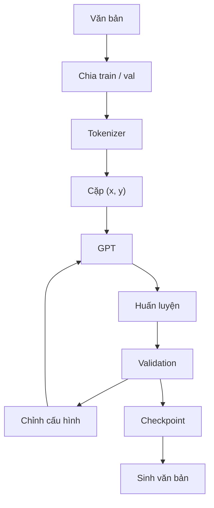

# LLM-from-scratch
Dựng một LLM từ đầu bởi tnHuy

## Mốc đầu tiên

Huấn luyện một GPT decoder-only dự đoán ký tự tiếp theo trên Tiny Shakespeare.
Các file Python hiện là khung triển khai. Bắt đầu trên CPU và cân nhắc CUDA
trên RTX 5050 ở lượt sau.

| Vị trí | Vai trò |
| --- | --- |
| `prepare.py`, `tokenizer.py`, `dataset.py` | Chia dữ liệu, mã hóa ký tự và tạo mẫu next-token. |
| `model.py`, `train.py` | Định nghĩa GPT và vòng lặp huấn luyện. |
| `evaluate.py`, `generate.py` | Đo validation loss và sinh văn bản từ checkpoint. |
| `data/` | Chứa dữ liệu gốc và dữ liệu đã xử lý trên máy. |
| `experiments/`, `runs/` | Lưu cấu hình và ghi chú trong Git. Checkpoint và log từng lần chạy nằm trong `runs/`. |

1. Chia corpus thành hai đoạn train và val trước khi tạo cửa sổ. Tạo vocabulary
   từ train và ánh xạ ký tự ngoài vocabulary sang `<unk>`.
2. Kiểm tra cặp `x`, `y` trên chuỗi nhỏ. Với `[A, B, C, D]` và context 3,
   `x = [A, B, C]`, `y = [B, C, D]`.
3. Kiểm tra causal mask và thử overfit một batch trước khi chạy toàn bộ corpus.
4. Ghi validation loss và sinh mẫu từ checkpoint được chọn. Dùng kết quả để chọn
   một thay đổi cho lượt tiếp theo.

Cấu hình giả định nằm trong
[`001_char_gpt/config.toml`](experiments/001_char_gpt/config.toml).
